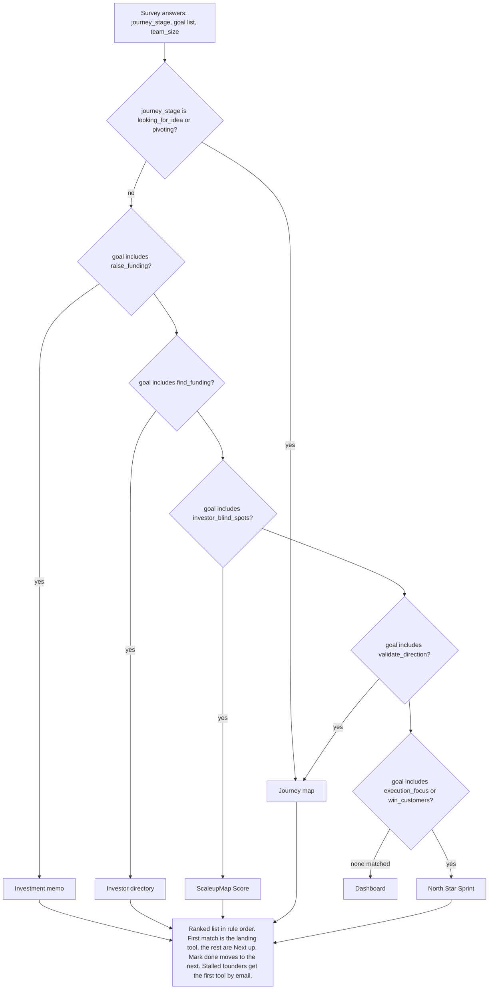

# Pitch (3 minutes, both challenges)

Demo logins, password `password`: `fresh@demo.test` (new), `maya@demo.test` (raising, lands on memo), `sam@demo.test` (unsure, lands on journey map), `omar@demo.test` (all tools done), `stalled@demo.test` (re-engage target).

Before you start: `php.bat artisan migrate:fresh --seed`, `composer run dev`, open `/` logged out, Light theme.

## Script

1. **Problem, 20 seconds.** Kinza's own words tonight: the landing page "looks AI coded, no authentic taste", and "screenshots of the product go stale". Founders who do sign up land on a dashboard with a dozen tools and do not know where to start. Some never come back.

2. **Before and after, 30 seconds.** Show `pitch/before-hero.png` next to `/`. Before: 5 nav links, 3 audience tabs, a trademark question as the headline, 22 sections. After: one headline for one audience, one button, and the product rendered in HTML. Flip "What you see" to "What investors see" on the hero card. That flip is the whole pitch: the same venture, now with the four red flags an investor spots in ten minutes. Hover a flag, read the question they will ask. Click a journey stage below. The tools light up for that stage. Nothing on this page is an image, so nothing goes stale.

3. **Challenge 2, click through, 70 seconds.** Click "Score my startup free". Register as a new founder. Same promise on the sign-up card, "Step 1 of 4". Three questions with ScaleupMap's real answer keys: "Raising a first round", then both "Raising feels overwhelming" and "Finding investors and funding", then "2 to 5 people". Land on the Investment memo. Read the line: "Because you said Raising feels overwhelming." First action on screen. Checklist: memo now, Investor directory next. Click "Done, show next tool". You are on the Investor directory, memo ticked.

4. **Two users, two results, 20 seconds.** Sign out. Sign in as `sam@demo.test`. Dashboard sends him straight to the Journey map with a different reason. Same rule table, different answers, different destination.

5. **Bonus, 20 seconds.** Sign in as `stalled@demo.test`, open `/mail/re-engage/{id}`. The email names the tool she never opened and quotes her own answer. In the terminal: `php.bat artisan onboarding:re-engage`. Output: "Wrote to stalled@demo.test". Scheduled daily, sent once.

6. **Why it holds, 15 seconds.** One ordered rule table decides landing, checklist order and the email, so they never disagree. Every rule has a Pest test. 74 feature tests green. Brand kit with tokens, no hex, light and dark.

7. **Next, 5 seconds.** Real ScaleupMap routes behind the five stubs. Opened state per tool so the dashboard shows landed, opened, done. Role carried from the landing tab through sign-up so `/welcome` is skipped.

## Decision logic

Rules live in `app/Onboarding/OnboardingRouter.php`, questions in `app/Onboarding/questions.php`, tools in `app/Onboarding/destinations.php`.

## Fallback

Screenshots in `pitch/`, in order: `before-hero.png`, `landing-1440.png`, `variant-3-hero.png`, `variant-3-flip.png`, `variant-3-board.png`, `landing-logos.png`, `landing-footer.png`, `landing-390.png`. Eight explored directions at `/v/1` to `/v/8` if a judge asks about process.

## Likely questions

- Why rules and not AI? Rules are explainable to a founder and testable tonight. JEV or an LLM can replace the table later behind the same interface.
- Does it work on mobile? Yes, 390px checked on the landing, sign-up and step pages.
- What did you cut? Opened-state tracking, the landing browser test, the UX review pass. All listed in `docs/TODOLIST.md`.
